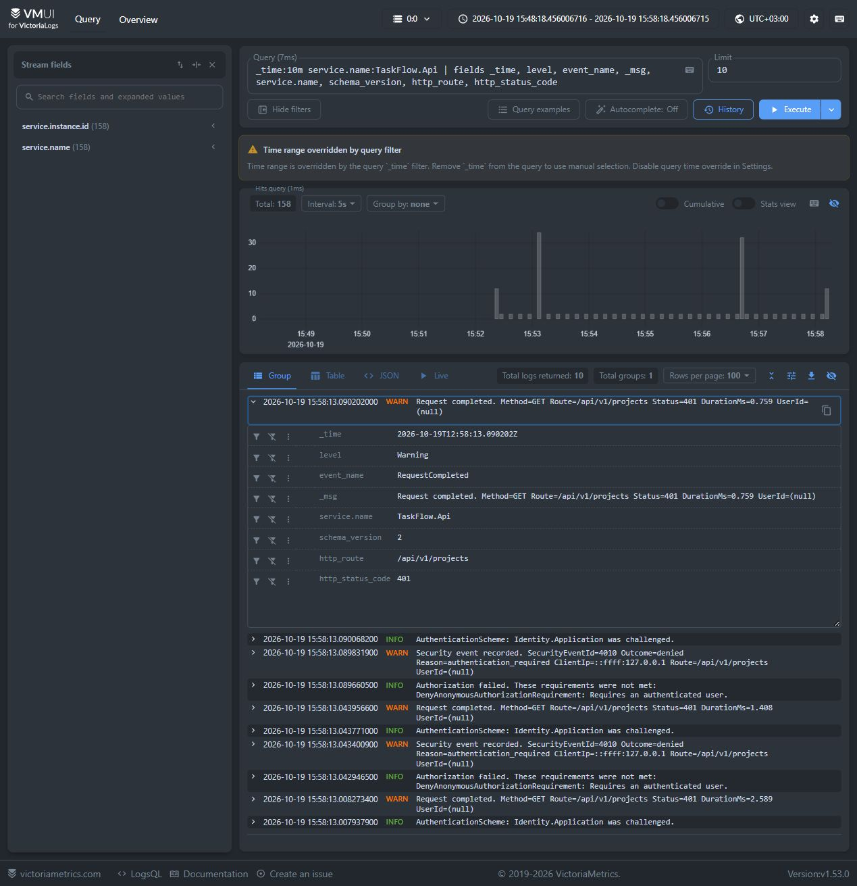
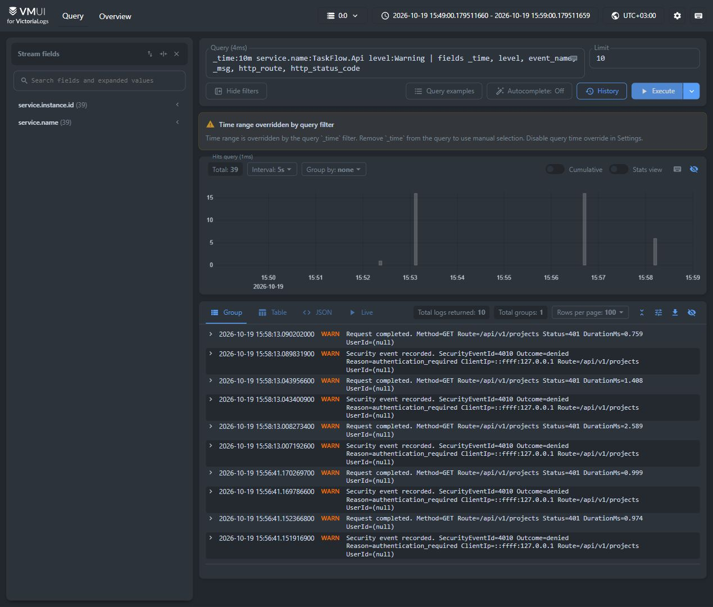
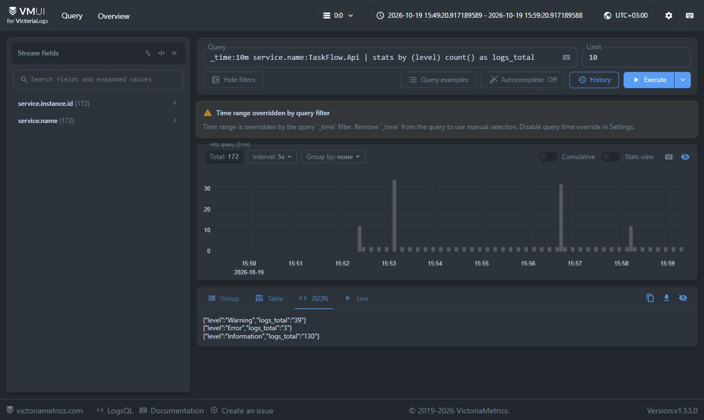
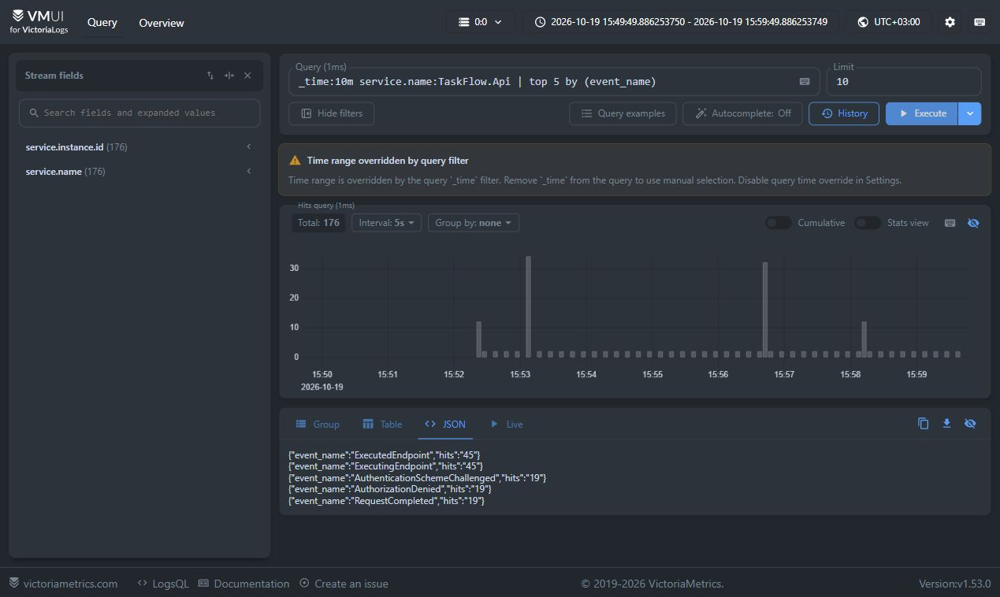
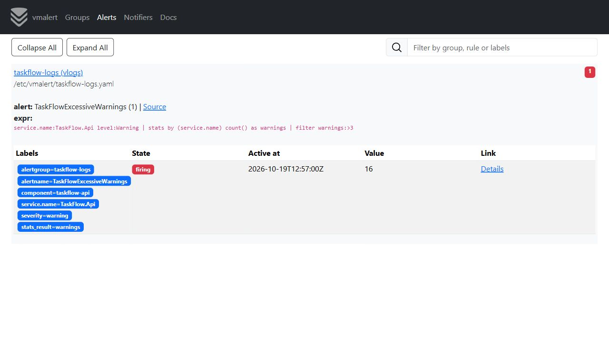

# Отчёт — ДЗ 3: Victoria Logs в minikube

TaskFlow работает в minikube-кластере в namespace `taskflow`. Для приложения настроены JSON-логирование, сбор записей через Vector, хранение в Victoria Logs и правило оповещения vmalert. Ниже приведены схема доставки, запросы LogsQL и снимки их результатов. Окно `_time:10m` движется, поэтому число записей при повторном запуске запросов меняется.

## Где находятся файлы развёртывания

| Файл | Что в нём |
|---|---|
| [`kubernetes/victoria-logs.yaml`](../victoria-logs.yaml) | Одноузловой Victoria Logs: Deployment, внутренний Service на порту 9428, PVC `victoria-logs-data` на 2 GiB. |
| [`kubernetes/vector.yaml`](../vector.yaml) | ServiceAccount, права только на чтение метаданных Kubernetes, ConfigMap с конфигурацией Vector, DaemonSet. |
| [`kubernetes/vmalert.yaml`](../vmalert.yaml) | Бонус: правило LogsQL, Deployment и Service vmalert, учебный Alertmanager. |
| [`kubernetes/kustomization.yaml`](../kustomization.yaml) | Подключает все три манифеста к развёртыванию приложения. |
| [`TaskFlowJsonConsoleFormatter.cs`](../../src/TaskFlow.Infrastructure/Observability/TaskFlowJsonConsoleFormatter.cs) | Формирует JSON-строки API для stdout с полями `timestamp`, `level`, `message`, `service.name` и прикладным контекстом. |

Исходный код форматтера находится в [TaskFlowJsonConsoleFormatter.cs](../../src/TaskFlow.Infrastructure/Observability/TaskFlowJsonConsoleFormatter.cs).

## Как лог попадает в Victoria Logs

API пишет по одному JSON-объекту на строку в stdout. Kubernetes сохраняет stdout в журнале Pod на узле. Vector с источником `kubernetes_logs` читает `/var/log/pods`, отбирает только контейнер `api` в namespace `taskflow`, разбирает JSON и отправляет записи в `victoria-logs.taskflow.svc.cluster.local:9428` через Elasticsearch bulk endpoint. В настройках приёма `message` превращается в `_msg`, `timestamp` — в `_time`; остальные поля доступны для LogsQL.

DaemonSet выбран потому, что он запускает Vector на каждом узле, где может работать реплика API. При масштабировании API новый Pod начинает собираться тем же агентом без сайдкара и без прямой зависимости приложения от адреса хранилища логов.

Пример строки из stdout контейнера API, доступной через `kubectl logs deployment/taskflow-api -n taskflow` (показаны основные поля):

```json
{"timestamp":"2026-10-19T15:58:13.090202+03:00","level":"Warning","message":"Request completed. Method=GET Route=/api/v1/projects Status=401 DurationMs=0.759 UserId=(null)","service.name":"TaskFlow.Api","service.version":"dz3","service.instance.id":"taskflow-api-6dcdc9cbb7-n6jn6","event_name":"RequestCompleted","http_route":"/api/v1/projects","http_status_code":401,"schema_version":"2"}
```

Скриншот первого запроса ниже раскрывает ту же запись уже в Victoria Logs: видны `level=Warning`, `service.name=TaskFlow.Api`, `schema_version=2`, `http_route` и `http_status_code=401`. Тем самым сравниваются фактические поля stdout и хранилища, а не два разных формата.

## Четыре LogsQL-запроса в VMUI

VMUI доступен через `kubectl -n taskflow port-forward service/victoria-logs 9428:9428` по адресу `http://127.0.0.1:9428/select/vmui/`. Фильтр `_time:10m` в запросах задаёт интервал времени.

### 1. Сырые записи за последние 10 минут

```logsql
_time:10m service.name:TaskFlow.Api | fields _time, level, event_name, _msg, service.name, schema_version, http_route, http_status_code
```

Показывает отдельные записи API с временем, уровнем, именем события, текстом и HTTP-контекстом. На раскрытой записи `RequestCompleted` видно, что JSON-поля дошли из stdout до Victoria Logs; на момент снимка найдено 158 записей.



### 2. Фильтр по конкретному полю

```logsql
_time:10m service.name:TaskFlow.Api level:Warning | fields _time, level, event_name, _msg, http_route, http_status_code
```

Отбирает записи с полем `level=Warning`. На снимке видны события отказа в авторизации и ответы `401` для `/api/v1/projects`; найдено 39 предупреждений.



### 3. `stats` с группировкой

```logsql
_time:10m service.name:TaskFlow.Api | stats by (level) count() as logs_total
```

Группирует записи по значению `level` и считает их. В момент снимка результат: `Information=130`, `Warning=39`, `Error=3`.



### 4. Агрегирующий `top`

```logsql
_time:10m service.name:TaskFlow.Api | top 5 by (event_name)
```

Возвращает пять наиболее частых имён событий и число `hits` для каждого. На снимке первые два места занимают события health check (`ExecutedEndpoint` и `ExecutingEndpoint`, по 45); далее идут события авторизации и завершения запросов (по 19).



## Бонус: срабатывание vmalert

В `kubernetes/vmalert.yaml` правило типа `vlogs` проверяет каждую минуту, превысило ли число предупреждений от API порог 3 за минуту:

```logsql
service.name:TaskFlow.Api level:Warning | stats by (service.name) count() as warnings | filter warnings:>3
```

Сценарий демонстрации: восемь запросов `GET /api/v1/projects` без входа в систему вызывают ответы `401` и записи уровня `Warning`. На снимке правило `TaskFlowExcessiveWarnings` находится в состоянии **firing**, значение `16`: в минутном окне появилось 16 предупреждений (по два на запрос). Alertmanager принимает сигнал в учебный receiver `discard`.



## Воспроизведение

Из корня репозитория на Windows:

```powershell
powershell -ExecutionPolicy Bypass -File .\kubernetes\scripts\Build-And-Load.ps1 -Tag dz3
powershell -ExecutionPolicy Bypass -File .\kubernetes\scripts\Deploy.ps1
kubectl get deploy,ds,pods,pvc -n taskflow
kubectl logs deployment/taskflow-api -n taskflow --tail=10
kubectl -n taskflow port-forward service/victoria-logs 9428:9428
```

Последнюю команду оставляют работающей в отдельном окне PowerShell, затем открывают VMUI и выполняют запросы выше. Для бонуса во втором окне запускают `kubectl -n taskflow port-forward service/taskflow-vmalert 8880:8880` и открывают `http://127.0.0.1:8880/vmalert/alerts`.

Манифесты можно просмотреть командой `kubectl kustomize kubernetes`. Тесты JSON-форматтера запускаются командой `dotnet test tests/TaskFlow.IntegrationTests/TaskFlow.IntegrationTests.csproj --configuration Release --filter FullyQualifiedName~ObservabilityLoggingTests`.
