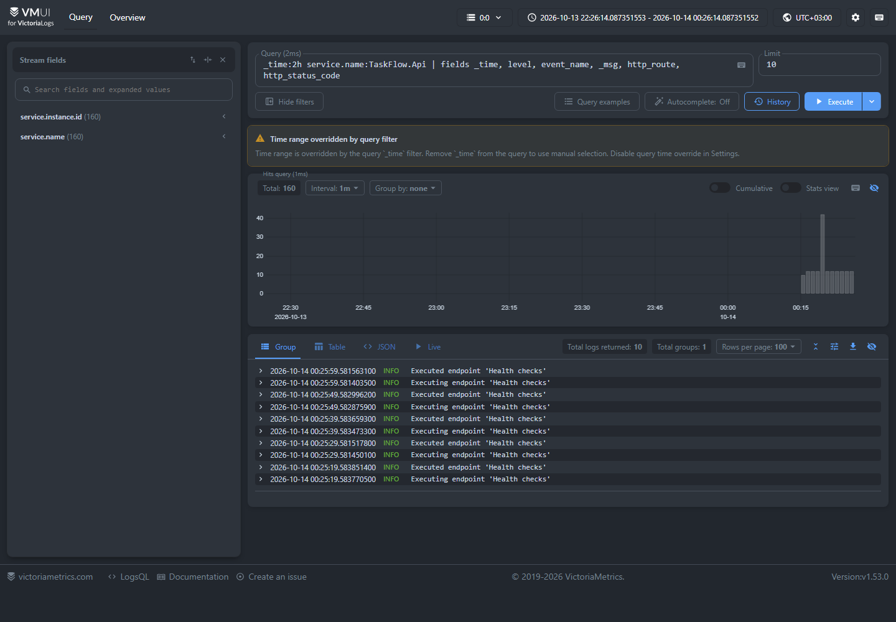
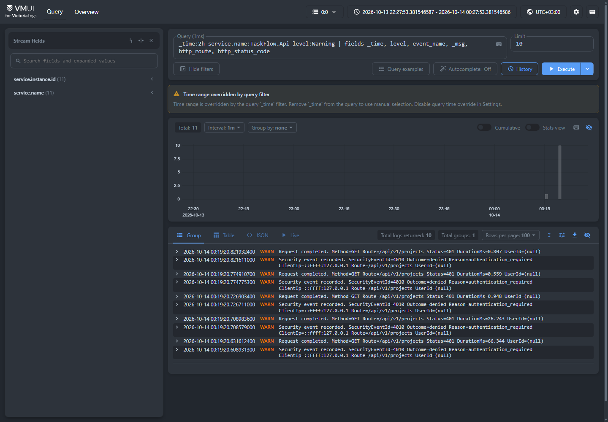
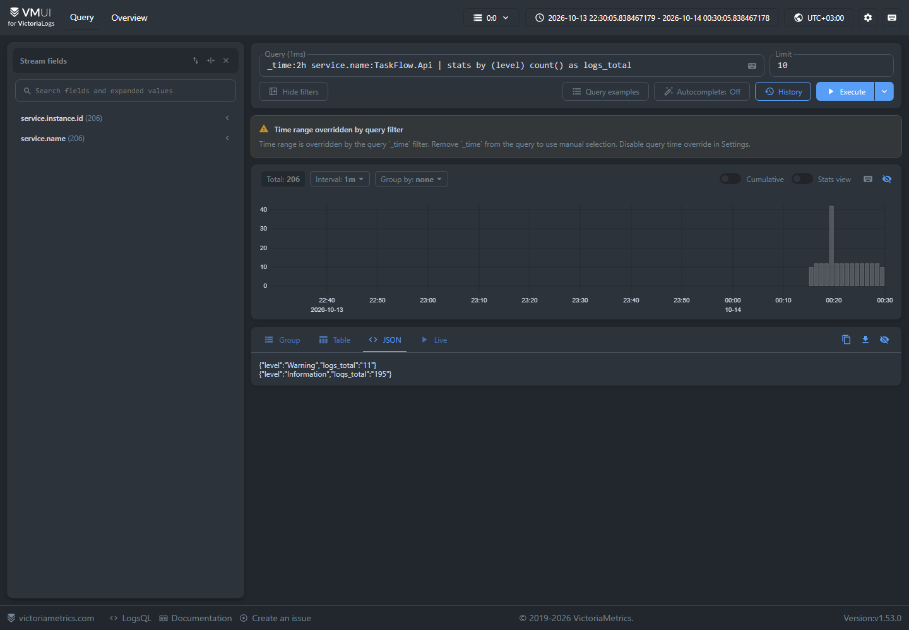
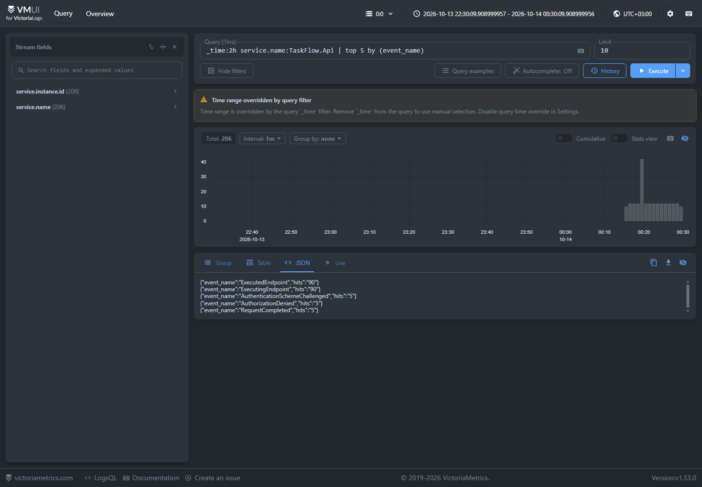

# Отчёт — домашнее задание 3: Victoria Logs

## Результат

В существующий namespace `taskflow` minikube-кластера добавлены:

| Компонент | Реализация | Назначение |
|---|---|---|
| Victoria Logs | `Deployment` `victoria-logs` + `Service` + PVC `victoria-logs-data` (2 GiB) | Одноузловое хранилище логов. Версия образа: `v1.53.0`. |
| Vector | `DaemonSet` `taskflow-vector` | На каждом узле читает `/var/log/pods`, отбирает только контейнер `api` из namespace `taskflow`, разбирает JSON и направляет его в Victoria Logs. Версия образа: `0.59.0-alpine`. |
| vmalert + Alertmanager | Два `Deployment` и ConfigMap с правилом | Бонус: поднимает alert `TaskFlowExcessiveWarnings`, если API создаёт больше трёх записей `Warning` за минуту. |

Все манифесты находятся уровнем выше в каталоге `kubernetes`: `victoria-logs.yaml`, `vector.yaml`, `vmalert.yaml` и `kustomization.yaml`.

## JSON-логи приложения

API пишет одну JSON-запись на строку в stdout. Минимальная схема, которую использует шиппер:

```json
{
  "timestamp": "2026-10-14T00:19:20.8219324+03:00",
  "level": "Warning",
  "message": "Request completed. Method=GET Route=/api/v1/projects Status=401 DurationMs=0.807 UserId=(null)",
  "service.name": "TaskFlow.Api",
  "service.version": "dz3",
  "service.instance.id": "taskflow-api-...",
  "event_name": "RequestCompleted",
  "http_route": "/api/v1/projects",
  "http_status_code": 401,
  "duration_ms": 0.807
}
```

Дополнительно сохраняются идентификаторы трассировки, запроса, события и безопасные прикладные поля. Секреты и неразрешённые структурированные поля отбрасываются форматтером до вывода в stdout.

## Почему выбран Vector DaemonSet

Vector запускается по одному экземпляру на узел, поэтому перехватывает stdout уже работающих и будущих реплик API без изменения их сетевой конфигурации и без сайдкара в каждом Pod. Источник `kubernetes_logs` читает `/var/log/pods` и использует только необходимые права `get/list/watch` к Kubernetes API для метаданных. После фильтра `taskflow/api` Vector разбирает JSON, оставляет метки Pod и отправляет события Elasticsearch bulk-совместимым sink в `http://victoria-logs.taskflow.svc.cluster.local:9428/insert/elasticsearch/`.

В sink заданы `_msg_field=message`, `_time_field=timestamp` и stream-поля `service.name,service.instance.id`; поэтому в Victoria Logs текст сообщения отображается как `_msg`, а исходные поля JSON доступны для LogsQL.

## Как воспроизвести

Из корня репозитория:

```text
powershell -ExecutionPolicy Bypass -File .\kubernetes\scripts\Build-And-Load.ps1 -Tag dz3
powershell -ExecutionPolicy Bypass -File .\kubernetes\scripts\Deploy.ps1
kubectl -n taskflow port-forward service/victoria-logs 9428:9428
```

После port-forward vmui доступен по адресу `http://127.0.0.1:9428/select/vmui/`.

## LogsQL-запросы и снимки vmui

Во всех запросах `_time:2h` ограничивает результаты двумя последними часами. Снимки созданы в vmui после реальной доставки логов API в Victoria Logs.

### 1. Сырые записи

```logsql
_time:2h service.name:TaskFlow.Api
| fields _time, level, event_name, _msg, http_route, http_status_code
```

Показывает последние записи API в читаемом виде: время, уровень, событие, текст и HTTP-контекст. Это базовая проверка доставки JSON-логов.



### 2. Фильтр по конкретному полю

```logsql
_time:2h service.name:TaskFlow.Api level:Warning
| fields _time, level, event_name, _msg, http_route, http_status_code
```

Фильтрует именно поле `level`. На снимке видны реальные `401` и события отказа в авторизации для `/api/v1/projects`.



### 3. `stats` с группировкой

```logsql
_time:2h service.name:TaskFlow.Api
| stats by (level) count() as logs_total
```

Считает число записей в каждой группе уровня логирования. Вывод vmui показывает отдельные итоговые значения для `Information` и `Warning`.



### 4. Агрегирующий `top`

```logsql
_time:2h service.name:TaskFlow.Api
| top 5 by (event_name)
```

Возвращает пять наиболее частых типов событий и их поле `hits`. Это позволяет быстро понять, какие операции доминируют в журнале; среди результатов видны health-check и события авторизации.



## Бонус: alert на базе LogsQL

В `vmalert.yaml` настроено правило типа `vlogs`:

```logsql
service.name:TaskFlow.Api level:Warning
| stats by (service.name) count() as warnings
| filter warnings:>3
```

`vmalert` вычисляет правило каждую минуту, а Alertmanager принимает срабатывания в учебный receiver `discard` (внешние уведомления не отправляются). Проверка после пяти намеренных запросов без аутентификации вернула состояние `firing` для `TaskFlowExcessiveWarnings` со значением `10`.
